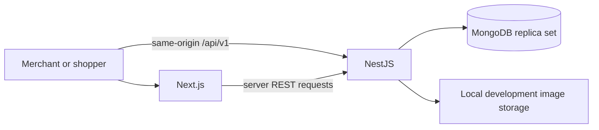

# Sallty (سلتي): خطة الـ Architecture

> تحديث 11 أكتوبر 2026: [Regional account experience](regional-account-experience.md)

الحالة: الأساس والحسابات وإدارة الكتالوج وPublic Storefront اتنفذوا محليًا؛ نتائج المراحل في docs/foundation.md وdocs/authentication.md وdocs/catalog.md وdocs/storefront.md. تاريخ المراجعة: 11 أكتوبر 2026.

## تحديث الحسابات ودعم الدول

الواجهة تدعم العربية الفصحى والإنجليزية، وRTL/LTR وLight/Dark. التسجيل يدعم 22 دولة عربية، وعملة المتجر ثابتة حسب الدولة. المتاجر القديمة تستمر بالجنيه المصري، ولا تُحوّل قيمها. استعادة كلمة المرور تعمل عبر Nodemailer برمز عشوائي قصير العمر واستخدام واحد وإلغاء الجلسات داخل Transaction. Admin دور مستقل يتحقق منه Backend، ولا يمنح تلقائيًا لأي حساب. تفاصيل القرارات والحدود في [regional-account-experience.md](regional-account-experience.md). وصف EGP فقط في الأقسام القديمة يسجل تصميم المرحلة الأولى، ولا يقيد المتاجر الجديدة.

## 1. الموجود حاليًا وإيه اتغيّر

المراجعة الأولى كانت لملفات التخطيط فقط. دلوقتي فيه pnpm Monorepo وNext.js وNestJS وMongoDB محلية، واختبارات فعلية. Node.js v24.21.0 وpnpm 12.10.1 مستخدمين على الجهاز؛ الإصدارات المثبتة في package.json وpnpm-lock.yaml.

الخطة القديمة اتبدلت بـ MongoDB + Mongoose وتطوير محلي، من غير VPS مدفوع أو اشتراك إجباري. اسم المشروع Sallty والدومين sallty.com متشترى من GoDaddy. Dependencies الضرورية اتثبتت؛ مفيش تغيير DNS أو تفعيل Cloud accounts.

Foundation والحسابات وإنشاء المتجر وإدارة الكتالوج وعرضه العام اتنفذوا. Phase 6 أضافت Cart وGuest COD Checkout وإدارة الطلبات والشحن الثابت المحلي، والتفاصيل في [orders.md](orders.md). النشر والإنتاج لم يتم تفعيلهما. مراجعة رحلة التاجر في [application-review.md](application-review.md)، وPhase 5 في [storefront.md](storefront.md).

## 2. الصورة العامة ببساطة

توسعة محرّر المتجر البصري يوم 14 أكتوبر 2026 موثقة في [visual-store-builder.md](visual-store-builder.md): أقسام مرتبة، مسودة خاصة منفصلة عن النشر، ومعاينة محمية تستخدم قالب المتجر الفعلي.

توسعة 13 أكتوبر 2026 للمنتجات الرقمية وتأكيد الدفع اليدوي والتسليم الخاص والثيمات موثقة في [digital-products-and-design.md](digital-products-and-design.md). لا تشمل أي تكامل دفع خارجي.

تأثيرات اللغة والمظهر والانتظار الموحد موثقة في [interface-motion.md](interface-motion.md)، باستخدام React وCSS وSVG الموجودة، بدون dependencies جديدة أو تغيير منطق Backend.

تحديث سهولة الاستخدام يوم 12 أكتوبر 2026: خطوات تجهيز فعلية في Dashboard، فصل المزايا المؤجلة عن الأقسام المتاحة، ودليل استخدام محمي في `/dashboard/help`. التفاصيل في [usability-review.md](usability-review.md). هذا تعديل للواجهات الحالية حتى Phase 6، بدون بدء Phase 7 أو تغيير صلاحيات البيانات.

هنستخدم Monorepo: repository واحد فيه Frontend وBackend. مثال: تعديل شكل صفحة المنتج وقواعد حفظ المنتج يبقوا في نفس المشروع، لكن كل جزء له مسؤوليته.

- Next.js: صفحات التعريف بالمنصة، لوحة التاجر، وصفحات كل المتاجر. Server Components تجيب البيانات من API لما يكون مناسب؛ Client Components للنماذج والـ cart والتفاعل.
- NestJS: API وقواعد الشغل، زي تسجيل الدخول، التأكد من صاحب المنتج، وحساب سعر الطلب.
- MongoDB: تخزين البيانات في collections؛ collection زي مجموعة documents للمنتجات.
- Mongoose: تعريف شكل document والتحقق منه والتعامل مع MongoDB من NestJS. ده ODM: بيربط objects في الكود بالـ documents في قاعدة البيانات.
- كل المتاجر تستخدم نفس التطبيق ونفس database. مش هننشر تطبيق منفصل لكل تاجر.



محليًا Next.js وNestJS يشتغلوا على ports مختلفة، وNext يعمل rewrite لمسار /api/v1 للـ API. المتصفح يتعامل مع origin واحد عشان cookies تبقى أبسط. Server Components تستخدم API URL داخلي وتبعت session cookie المطلوبة بس. Next.js ملوش MongoDB credentials. النشر العام والـ proxy/TLS قرار لاحق.

Multi-tenant معناها إن تاجر الملابس وتاجر الإكسسوارات على نفس النظام، لكن كل واحد يشوف بيانات متجره بس. هنبدأ بتجار كتير، كل تاجر يمتلك متجر واحد؛ staff accounts وامتلاك أكتر من متجر لنفس الحساب مؤجلين. ده مش معناه إن المنصة فيها متجر واحد.

## 3. هيكل المشروع المقترح

```text
apps/
  web/
    src/app/                  # pages and layouts
    src/components/           # UI components
    src/features/             # auth, products, cart...
    src/lib/api/              # API access helpers
  api/
    src/modules/              # auth, stores, catalog, orders, uploads
    src/common/               # validation, authorization, errors
    src/database/             # MongoDB connection, scoped repositories
    src/database/scripts/     # indexes and versioned data changes
    test/
packages/
  contracts/                  # shared Zod schemas and response types
  config/                     # shared TypeScript/lint settings
tests/e2e/
infra/local/                  # local replica-set setup when needed
docs/
  architecture.md
  roadmap.md
AGENTS.md
package.json
pnpm-workspace.yaml
pnpm-lock.yaml
.env.example
```

الهيكل بيعرض اتجاه المشروع؛ التنفيذ الحالي داخل apps/web وapps/api وpackages/contracts وpackages/config، من غير folders فاضية. shadcn/ui components داخل web، ونطلع packages/ui بس لما يبقى فيه احتياج فعلي لإعادة الاستخدام.

## 4. الـ Stack وفحص التوافق

| الجزء      | الاختيار                                   | اللي لازم نراجعه قبل التثبيت                                                   |
| ---------- | ------------------------------------------ | ------------------------------------------------------------------------------ |
| Runtime    | Node.js supported LTS                      | نفس إصدار متوافق محليًا وفي CI؛ الإصدار الموجود مش دليل إن كل packages متوافقة |
| Frontend   | Next.js stable App Router + matching React | engines وReact peer dependencies                                               |
| Language   | TypeScript strict                          | إصدار متوافق مع Next/Nest وlint tools                                          |
| Styling    | Tailwind CSS v4 + shadcn/ui                | PostCSS setup وReact/RTL support؛ components عند الحاجة                        |
| Backend    | NestJS + @nestjs/mongoose + Mongoose       | توافق Nest major مع integration package وMongoose/MongoDB driver               |
| Database   | MongoDB Community محليًا                   | نسخة مدعومة من driver، وتشغيل replica set للـ transactions                     |
| Workspace  | pnpm                                       | تثبيت نسخة مناسبة وتثبيتها في packageManager                                   |
| Validation | Zod                                        | shared contracts من غير إضافة مكتبات تكرر نفس الشغل                            |

مش هنختار latest بشكل عشوائي. هنراجع exact versions وpeer dependencies، ونجرب اتصال MongoDB وbuild قبل features. توثيق [NestJS مع Mongoose](https://docs.nestjs.com/techniques/mongodb) بيشرح integration، لكنه مش بديل عن install/build verification.

## 5. تصميم MongoDB المناسب للبداية

Document مثال: منتج فيه name وpricePiastres وstoreId. Embedded data يعني بيانات جوه نفس document؛ هنخزن عنوان الطلب وبنوده جواه لأنهم نسخة ثابتة من لحظة الشراء. Reference يعني ID يشير لـ document تاني؛ MongoDB مش بيضمن إن المرجع موجود أو تابع لنفس المتجر، وده لازم Backend يراجعه.

| Collection         | أهم البيانات والقواعد                                                                                                                                                                      |
| ------------------ | ------------------------------------------------------------------------------------------------------------------------------------------------------------------------------------------ |
| users              | normalizedEmail unique، passwordHash، emailVerifiedAt عند تفعيل verification، timestamps                                                                                                   |
| sessions           | userId، tokenHash unique، expiresAt، lastSeenAt، revokedAt؛ TTL index للتنضيف                                                                                                              |
| accountTokens      | recovery/verification tokens hashed، expiry وconsumedAt؛ تتضاف مع تنفيذ flows دي                                                                                                           |
| stores             | ownerId unique، slug unique، name، logoAssetId، publishedAt، checkoutVersion، settings embedded                                                                                            |
| products           | storeId، slug، name، plain-text description، pricePiastres، stockQuantity، categoryId optional، status، images bounded array، version                                                      |
| categories         | storeId، name، slug؛ unique index على storeId + slug                                                                                                                                       |
| mediaAssets        | storeId، generatedStorageKey، kind، verified metadata، state؛ ملكية الصورة مستقلة قبل ربطها                                                                                                |
| orders             | storeId، orderNumber random unique within store، customer embedded، address embedded، items snapshots bounded، totals، COD status، version، receiptTokenHash، receiptExpiresAt، timestamps |
| orderEvents        | storeId، orderId، previous/new status، actor، reason، eventKey؛ append-only                                                                                                                |
| inventoryMovements | storeId، productId، orderId optional، delta، reason، eventKey؛ unique storeId + eventKey                                                                                                   |
| checkoutRequests   | storeId، idempotencyKey، requestHash، orderId، expiry؛ unique storeId + key                                                                                                                |
| rateLimitBuckets   | key/window unique، count، expiresAt؛ bounded durable limits في التطبيق الصغير                                                                                                              |

StoreSettings embedded في Store، وProductImages embedded references في Product، وOrderItems/OrderAddress/customer snapshot embedded في Order. كده مش محتاجين collection لكل حاجة. Customer collection مستقلة وsaved addresses مؤجلين؛ customer list في أول MVP تتجاب من orders scoped للمتجر، من غير تعديل معلومات الطلب القديم.

ObjectId للـ IDs، وDate محفوظة UTC وعرض Africa/Cairo. الفلوس Number صحيح بالقروش: EGP 125.50 تتخزن 12550. نستخدم Number.isSafeInteger وحدود صغيرة موثقة للسعر والكمية وعدد items ومجموع الطلب؛ نرفض أي overflow في الضرب أو الجمع. أي احتياج مالي أكبر لاحقًا يتراجع له BSON Long/Decimal128 بدل تغيير التمثيل من غير خطة.

Unique Index هو قاعدة في database تمنع التكرار حتى لو طلبين وصلوا مع بعض؛ مثال تاجرين يحاولوا نفس slug. Mongoose unique مش validator؛ لازم index يتعمل فعليًا ونعالج duplicate-key errors.

Indexes: users.email، stores.slug وownerId؛ products(storeId, slug) unique و(storeId, status, _id)؛ categories(storeId, slug) unique؛ orders(storeId, createdAt, _id) و(storeId, orderNumber) unique؛ event/idempotency indexes. Pagination محدودة، وحدود arrays تمنع documents ضخمة؛ history مش array بتكبر للأبد جوه Order.

MongoDB مفيهاش ضمان علاقات بين collections زي بعض databases التانية. أي categoryId/assetId/productId/orderId لازم يتراجع داخل نفس authorized storeId قبل الربط. Collections validators لقواعد النوع والنطاق، وMongoose validation للـ application؛ الاتنين مش بيعملوا authorization. تحديثات مسموحة فقط، runValidators حيث ينطبق، وconditional writes تمنع stock سالب. Index/validator scripts versioned بدل الاعتماد على autoIndex في production؛ data changes تكون idempotent ومجربة مع backup.

## 6. الحسابات وعزل التجار

تأكيد البريد الإلكتروني إلزامي قبل Store/Catalog endpoints باستخدام OTP وNodemailer/Gmail SMTP. التفاصيل في [email-verification.md](email-verification.md). Products/Categories نُفذت في Phase 4، وPassword Recovery نُفذت في تحديث الحسابات. تأكيد الهاتف وOrders ما زالا مؤجلين.

Authentication يعني نعرف مين المستخدم؛ Authorization يعني نحدد هو مسموح له يعمل إيه. مثال: أحمد عمل login بنجاح، لكن ده مش إذن يعدل منتج متجر منى.

هنستخدم Argon2id لكلمات السر، وopaque server-side sessions محفوظة hashed في MongoDB. Cookie HttpOnly، SameSite=Lax، وSecure في HTTPS production؛ local HTTP له إعداد تطوير منفصل. Production cookie host-only باسم __Host-sallty_session. لا tokens في localStorage. انتهاء session يتراجع في API حتى لو TTL لسه ممسحهاش؛ TTL cleanup مش فوري.

Backend يجيب store من user ownership، وبعدها كل query فيها storeId الموثوق. مثال filter لمنتج يكون {_id: productId, storeId: authorizedStoreId}؛ نفس الفلتر في update/delete. List، count، aggregations، exports وimages كلها scoped. ممنوع browser يحدد tenant authorization، وممنوع populate غير مقيّد يكشف بيانات متجر تاني.

Zod للطلبات، field allowlist للتحديث، parsing واضح لـ ObjectId، وممنوع تمرير req.body أو query كـ MongoDB filter. ده يمنع NoSQL injection؛ مثال حد يبعت operator زي $ne مكان قيمة عادية. signed session-bound CSRF token وexact Origin checks للـ cookie writes، ومفيش CORS خارجي. rate limits في MongoDB وbody limit 16 KiB ورسائل errors آمنة. تفاصيل التنفيذ والـ local proxy limits في docs/authentication.md.

اختبارات حقيقية ضد MongoDB replica set: تاجر A يحاول read/update/delete منتجات B، يربط category/image من B، يشوف orders/customers/settings/analytics بتوعه، أو يبعت storeId مزور. الـ UI لوحدها مش حماية.

Phase 5 Public API ترجع branding وACTIVE products حسب Store Slug. مفيش published flag حاليًا؛ أي متجر موجود له رابط عام، وActive هو تصريح التاجر بعرض المنتج. إضافة نشر/إخفاء المتجر كله قرار لاحق. DTOs صريحة من غير passwords أو emails خاصة أو addresses أو SKU أو stockQuantity أو storage keys. الردود والصور no-store علشان الأرشفة تتطبق على الطلبات الجديدة فورًا؛ deduplication داخل نفس Server Render فقط. أي caching لاحق keys فيها storeId مع invalidation. تفاصيل المرحلة في [storefront.md](storefront.md)، وCheckout الحالية في [orders.md](orders.md).

## 7. Checkout ومنع بيع آخر قطعة مرتين

Phase 6 الحالية موثقة في [orders.md](orders.md). Idempotency محفوظة داخل Order مع Unique Index، وسجل الحالات المحدود embedded في Order. orderMovements منفصلة بسجل فريد للحجز والاستعادة. Checkout مصري وEGP مع شحن ثابت يُحفظ صراحةً؛ لا رسوم افتراضية. المتاجر الدولية تحتفظ بالكتالوج والدعم الإقليمي.

Transactions معناها مجموعة تغييرات تنجح كلها أو تتلغي كلها. MongoDB multi-document transactions محتاجة replica set؛ standalone مش كفاية. هنستخدم single-node replica set محليًا، مناسب للتطوير لكنه مفيهوش redundancy. [MongoDB replication documentation](https://www.mongodb.com/docs/manual/replication/) بتوضح دعم transactions في replica sets.

الـ cart منفصلة لكل Store Slug، فيها Product Slugs وquantities بس. API يحسب الأسعار والشحن من database، مش من المتصفح. EGP، guest checkout، COD، محافظة/مدينة/عنوان، وتطبيع الأرقام العربية والموبايل المصري للصيغة +20. الصيغ المحلية المقبولة تبدأ 010/011/012/015 وباقي الرقم 8 أرقام؛ ده فحص format مش إثبات ملكية الرقم.

Transaction قصيرة باستخدام Mongoose Connection.transaction، مع snapshot read concern وmajority write concern:

1. فحص Order سابق بنفس storeId وHash المفتاح؛ نفس البيانات تعيد نفس النتيجة، وتغييرها يرجع 409.
2. تحديث catalogRevision للـ Store؛ تعديلات الكتالوج والشحن تكتب نفس الوثيقة، فتتعارض الكتابات المتزامنة وتُعاد المعاملة على بيانات حديثة.
3. قراءة Active products لنفس Store وحساب totals، والتحقق من Quote Token الموقع للموافقة على السعر والشحن، ثم conditional stock updates بالمخزون >= quantity.
4. حفظ Order وimmutable product/customer/address/shipping snapshots، وorderMovements، وHashes للمفتاح والبيانات وإثبات التأكيد. Unique Index يمنع إنشاء طلبين بنفس المفتاح.
5. Commit؛ أي فشل يرجّع المخزون والتغييرات زي ما كانت.

كل operation تستخدم نفس MongoDB session، ومفيش Promise.all جوه transaction أو email/upload side effects؛ callback ممكن يتعاد في retry. [Mongoose transactions](https://mongoosejs.com/docs/transactions.html) بتشرح session handling وحدود parallel operations.

حماية Idempotency تفضل طول ما Order محفوظ، من غير TTL تمسحها. المفتاح 256 bit محفوظ في sessionStorage من غير بيانات العميل. Recover بعد ضياع الرد يحتاج نفس المفتاح، ويعيد إثبات التأكيد المشتق منه. Database تخزن Hash فقط؛ Receipt مدتها 7 أيام وتعرض الرقم والحالة فقط. لا يوجد Public lookup عبر Order ID ولا بيانات عميل في الرد العام.

Lifecycle: PENDING → CONFIRMED → PROCESSING → SHIPPED → DELIVERED. الإلغاء من أول ثلاث حالات فقط، ونهائي، ويستعيد المخزون مرة واحدة داخل Transaction مع سجل RESTORE فريد. المنتج المؤرشف يستقبل المخزون، وأي فشل استعادة يلغي العملية كلها. SHIPPED لا يُلغى، وDELIVERED وCANCELLED نهائيتان. المرتجعات وتسويات ما بعد الشحن مؤجلة.

## 8. الصور والإيميل والأدوات المجانية

الاختيار الأول local development من غير cloud accounts. تكلفة اشتراكات التطوير المستهدفة صفر، بخلاف جهازك/الكهرباء/الإنترنت وتجديد الدومين الموجود.

| الأداة                                            | الاستخدام                           | الحدود والقرار                                                                                                                               |
| ------------------------------------------------- | ----------------------------------- | -------------------------------------------------------------------------------------------------------------------------------------------- |
| Node.js، pnpm، Git، Next/Nest، Tailwind/shadcn/ui | تشغيل وكتابة المشروع محليًا         | أدوات مجانية؛ dependencies بقدر الحاجة                                                                                                       |
| MongoDB Community محليًا                          | database بـ replica set             | مفيش اشتراك، محتاج مساحة/RAM وإعداد backup؛ single-node للتطوير فقط. ترخيصه SSPL، مش هنقدم MongoDB نفسها كخدمة hosting                       |
| MongoDB Compass                                   | فحص الـ documents                   | أداة اختيارية؛ منع استخدامها لتعديل production يدويًا بدون إجراء واضح                                                                        |
| Local file storage                                | product/logo images أثناء التطوير   | folder خارج source/public، IDs مولدة، ownership، raster-only validation، byte/dimension/count limits؛ مش storage مناسب على hosting ephemeral |
| Local email capture                               | verification/recovery أثناء التطوير | مبيبعتش إيميل حقيقي؛ اختيار أداة محلية لما نحتاجها، tokens من غير production logs                                                            |
| MongoDB Atlas Free                                | بديل اختياري لو التشغيل المحلي صعب  | مش default ومش هننشئ حساب دلوقتي؛ القيود تحت                                                                                                 |
| Cloud image/email providers                       | نشر لاحق                            | اختيار لاحق بعد مراجعة quotas وشروط الاستخدام وcard requirement معاك                                                                         |

Atlas Free حاليًا: 0.5 GB للبيانات والـ indexes، 100 operations/second، 500 connections، 10 GB داخل و10 GB خارج كل 7 أيام، ومفيش built-in backups؛ بيوقف بعد 30 يوم inactivity. مناسب لتجربة صغيرة، مش ضمان لإطلاق تجاري مستقر. نسخة database والـ regions محدودة. [القيود الرسمية](https://www.mongodb.com/docs/atlas/reference/free-shared-limitations/).

MongoDB ذكرت في إعلان رسمي إن Free tier مش محتاجة credit card؛ الإعلان قديم، فهنراجع شروط وشاشة التسجيل وقت الاختيار، وأي طلب card نوقف ونناقشه قبل الاستكمال. [الإعلان الرسمي](https://www.mongodb.com/company/blog/product-release-announcements/free-your-genius-on-mongodb-atlas-free-tier). مفيش ترقية تلقائية أو paid tier هنفعّله.

مش هنرشح Vercel Hobby أو أي free host تجاري من غير مراجعة commercial-use terms وقيود sleep وpersistent storage والـ Backend. NestJS محتاج hosting مناسب؛ الدومين لوحده مش بيشغّل server. القرار الحالي: local فقط. ميزانية public production لسه غير محددة؛ نشر عملي ممكن يحتاج تكلفة لاحقًا، ومش هنعدك إن كل الخدمات هتفضل مجانية.

## 9. الـ MVP وإيه مؤجل

أول MVP: register/login، إنشاء store، منتجات/category/صور/stock، settings/publish، متجر عام بواجهة واحدة، cart/guest checkout/COD، إدارة الطلبات وملخص مبيعات حقيقي. العربية RTL، mobile-first، EGP وWhatsApp link من غير messaging API. مفيش fake sales أو testimonials، وفيه loading/error/empty states وkeyboard-accessible forms.

Routes: /store/[storeSlug]، /store/[storeSlug]/products/[productSlug]، /store/[storeSlug]/cart، /store/[storeSlug]/checkout، وconfirmation آمن. Slug فريد lowercase ASCII وثابت في أول MVP. مثال للتوضيح فقط: /store/nour-clothes؛ مش متجر حقيقي.

Commission-based model مؤجل للتفعيل بموافقتك. MVP يحفظ totals/discount=0/shipping/status/payment timestamps والـ immutable snapshots عشان يدعم المرحلة دي. مفيش rate افتراضية مخترعة ولا ledger/billing system يتنفذ دلوقتي.

في المرحلة المالية المستقبلية: CommissionPolicy configurable، snapshots، append-only CommissionLedgerEntries بمفاتيح أحداث unique، accrual بعد DELIVERED وتأكيد COD collected فقط؛ مش عند إنشاء الطلب. Refund/adjustment يعكس أو يعدل بسجل جديد. التحصيل من التاجر يحتاج اتفاق وفواتير/statement ومتابعة يدوية؛ Sallty مش ماسكة فلوس COD. فيه مخاطر إخفاء delivery وعدم السداد؛ لازم سياسة فعلية قبل تقديم نموذج العمولة تجاريًا.

مؤجل كمان: staff/StoreMembers، variants/SKUs، coupons، payment/shipping integrations، messaging notifications، custom domains، multi-theme وadvanced analytics. سلامة tenant والـ checkout مش extras تتشال عشان نقلل MVP.

## 10. النشر والموافقة

قبل أي real customers: HTTPS، cookies/security headers، private database access، credentials محدودة، backups واسترجاع متجرب، upload storage دائم، account recovery حقيقي، redacted logs، monitoring وخطة تحديث dependencies. استضافة مجانية محدودة مش بتعفي من الحاجات دي.

هنراجع plan النشر وشروط الاستخدام وتكلفته وقتها ونطلب موافقتك قبل أي infrastructure ممكن تكلف فلوس أو تتطلب card. DNS الخاص بـ sallty.com مش هيتلمس إلا بإذن صريح وبعد readiness.

Phase 4 قراراتها في [catalog.md](catalog.md)، وPhase 5 في [storefront.md](storefront.md)، وPhase 6 المعتمدة يوم 11 أكتوبر 2026 في [orders.md](orders.md). المرجع الأخير يحل محل التصورات التاريخية عن Checkout/Orders. Phase 7 لن تبدأ من غير موافقة جديدة.
